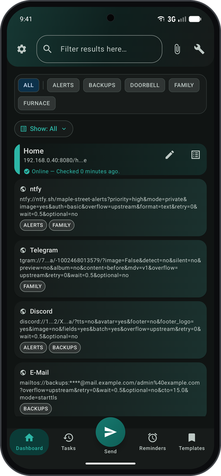
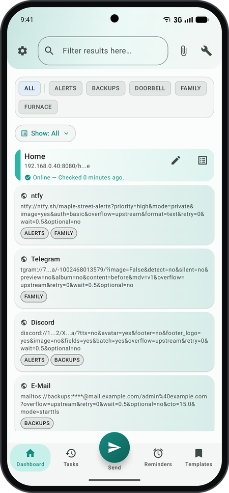
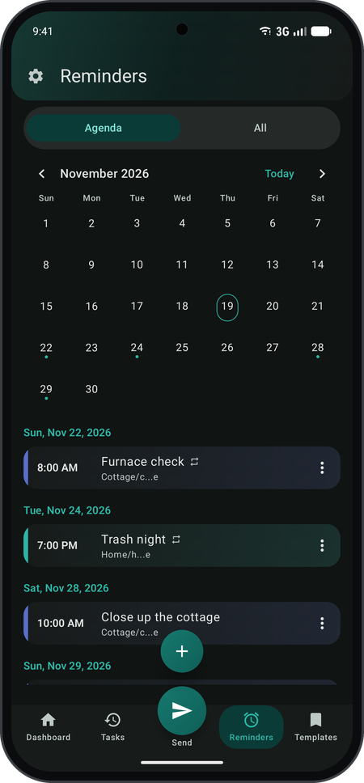
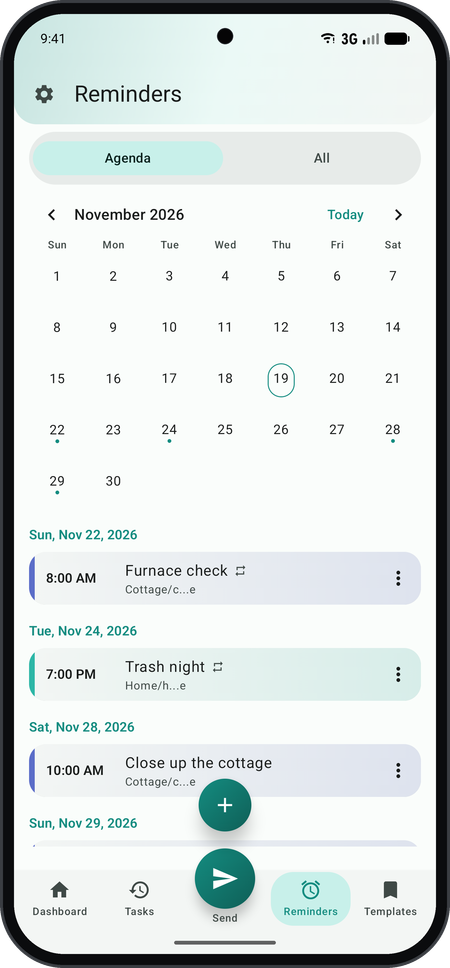
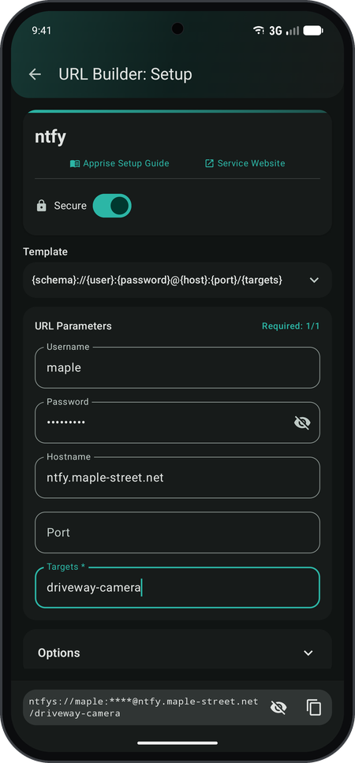
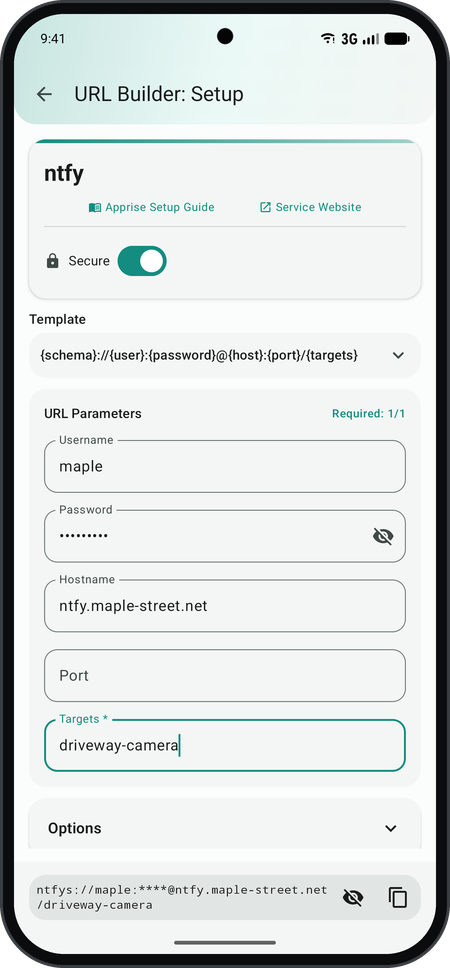
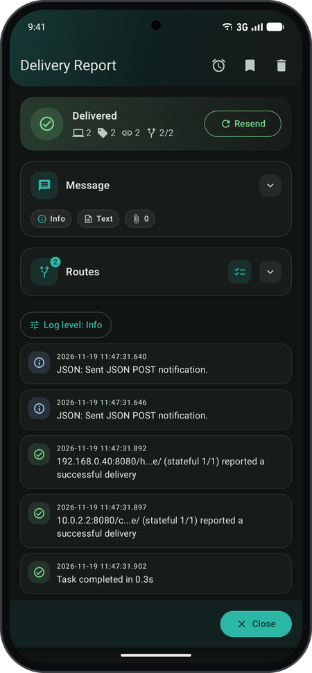
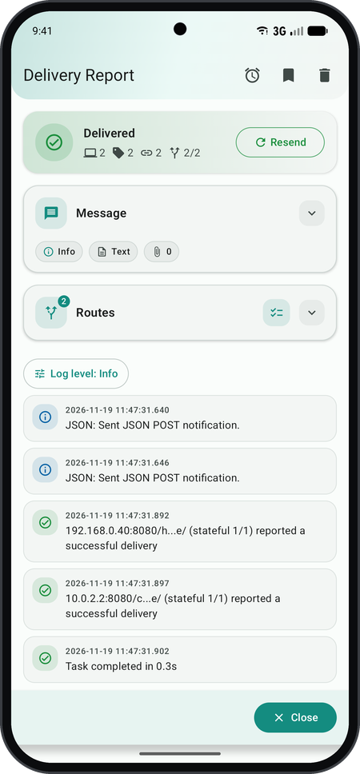

import "~/styles/mobile.css";
import MobileStoreLinks from "~/components/MobileStoreLinks.astro";
import AppriseOverview from "~/components/AppriseOverview.astro";
import MobileHeroPhone from "~/components/MobileHeroPhone.astro";

  <section class="mobile-hero">
    <MobileHeroPhone />
    

      Application Android et iOS
      <h2>Vos Notifications, Où que Vous Soyez</h2>
      

        Envoyez un message ou une photo que vous venez de prendre vers une destination, un groupe
        ou toutes les destinations configurées. Apprise Mobile relie votre téléphone ou votre tablette à
        <!-- SERVICES:COUNT --> services pris en charge grâce à votre API Apprise auto-hébergée.
      

      

        Pas encore le moment d'envoyer ? Créez un <a href="./reminders/">rappel</a> et votre serveur l'enverra plus tard, une seule fois ou de façon répétée, même si votre téléphone est éteint.
      

      

        Nécessite un <a href="../api/deployment/">serveur API Apprise</a> en cours d'exécution.
        Apprise Mobile est un client pour votre serveur, pas un service de notification à lui seul.
      

      <MobileStoreLinks lang="fr" />
    

  </section>

<section class="mobile-preview">
  <h2>Où se Place Apprise Mobile</h2>
  

    Apprise Mobile est un client pour un serveur que vous hébergez. Il dialogue
    avec votre API Apprise, qui se charge de la remise.
  

  <AppriseOverview
    highlight="mobile"
    alt="Apprise Mobile mis en évidence parmi les façons d'envoyer des notifications."
  />
</section>

<section class="mobile-preview">
  <h2>Envoyez Maintenant ou Gardez pour Plus Tard</h2>
  <ul>
    <li>
      <strong>Envoyez où que vous soyez.</strong> Contactez les personnes, les
      applications et les services qui comptent depuis votre téléphone.
    </li>
    <li>
      <strong>Partagez des photos et des fichiers.</strong> Prenez une photo ou
      choisissez un fichier, partagez-le avec Apprise Mobile, sélectionnez vos
      destinataires et envoyez.
    </li>
    <li>
      <strong>Réutilisez vos messages.</strong> La version complète permet
      d'enregistrer vos messages courants et leurs destinataires comme modèles,
      puis de les renvoyer à la demande.
    </li>
    <li>
      <strong>Connectez-vous rapidement.</strong> Scannez un code QR depuis
      l'interface Web de l'API Apprise pour ajouter un serveur et sa
      configuration.
    </li>
    <li>
      <strong>Modifiez au besoin.</strong> Travaillez sur les configurations
      distantes en Texte ou YAML avec le formatage, le signalement des erreurs,
      les actions Annuler et Rétablir, ainsi que la conversion locale.
    </li>
    <li>
      <strong>Planifiez des rappels.</strong> Enregistrez une notification que
      votre serveur enverra plus tard, une fois ou de façon répétée, même
      téléphone éteint. Voir <a href="./reminders/">Rappels</a>.
    </li>
  </ul>
</section>

  <section class="mobile-preview">
    <h2>Tout au Même Endroit</h2>
    

      Gérez vos serveurs, planifiez des rappels, créez des URL de service et suivez chaque envoi
      jusqu'à son rapport de livraison.
    

    

      <figure>
        
        
        <figcaption>Tableau de Bord</figcaption>
      </figure>
      <figure>
        
        
        <figcaption>Rappels</figcaption>
      </figure>
      <figure>
        
        
        <figcaption>Générateur d'URL</figcaption>
      </figure>
      <figure>
        
        
        <figcaption>Rapport de Livraison</figcaption>
      </figure>
    

  </section>

<section class="mobile-get">
  <h2>Connectez Votre Téléphone ou Votre Tablette</h2>
  

    Disponible pour Android 8.0 ou version ultérieure et pour iPhone ou iPad
    avec iOS 17.2 ou version ultérieure. Installez l'application depuis l'une
    des boutiques ci-dessus, connectez votre serveur API Apprise et envoyez
    votre première notification.
  

  <a class="mobile-get-link mobile-get-link-primary" href="./getting-started/">
    Configurer Apprise Mobile
  </a>
</section>

<nav class="mobile-legal" aria-label="Documents juridiques d'Apprise Mobile">
  <a href="./privacy/">Politique de confidentialité</a>
  <a href="./tos/">Conditions d'utilisation</a>
</nav>

